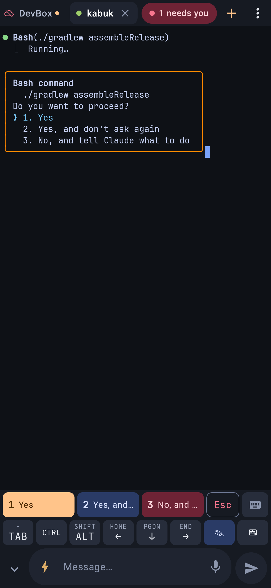
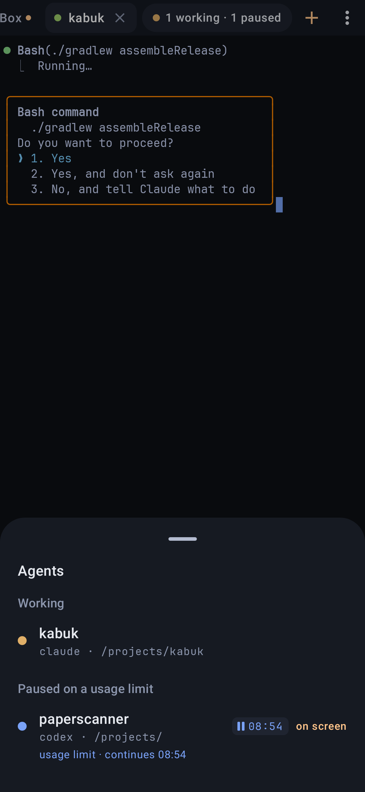

# Kabuk

**Kabuk** (Turkish for "shell") is an Android SSH terminal made for running Claude Code, Codex and other coding
agents on your dev server from a phone. It's a Termux replacement for that job: the same terminal engine, with
better keyboard input, copy and tabs. On top of the terminal there is an agents layer: the agents on the server,
their permission dialogs and the questions they ask you, and the server's workspaces, live on the phone and
answerable from a notification.

The agents layer talks to [**orchtool**](https://github.com/muratbilge/orchtool) (`orchd` + `orch`: panes,
workspaces and an agent bus for Claude Code and Codex) and falls back to **herdr**, which orchtool replaces.
Without either, Kabuk is a good terminal with tmux sessions that survive the connection.

<p align="center">
  
  
</p>
<p align="center">
  
</p>

## What it does

### Agents (orchtool)
- **Start with: orch.** The server's orch TUI runs in the tab, started through a login shell so the TUI, the
  orchd it starts and the agents those spawn get the real environment. Agents, their dialogs, the questions they
  ask you (`ask_human`), the message timeline and the workspace layout stream from `orch watch --json` over the
  same SSH connection; every action is a single `orch` command. Nothing to install besides orch on the server.
- **Agents sheet.** The chip in the tab bar says "1 needs you" or "2 working · 1 paused"; tap it for the agents
  grouped Needs you / Working / Paused on a usage limit / Done / Idle, each with its folder and workspace. A
  waiting agent shows its dialog with the answer buttons right there; tap the row to bring it on screen in the
  TUI. "Asks you" lists the questions agents asked on the bus, with the agent's options, Reply… and Dismiss.
  Comms shows the timeline and Message… to one agent or all. New agent starts Claude or Codex in a folder.
- **Answers that can't go astray.** A dialog is answered with `orch send --expect <screen hash>`: orchd sends
  only if the screen still shows what the phone read, and answers each dialog once, so a second phone or the TUI
  can't answer it again. Every outcome comes back in words: sent, the screen changed, answered already, the agent
  is gone or not taking input, orchd not running, or Kabuk and orch disagree (update one of them). The contract
  with orchtool (its `notes/kabuk-contract-v2.md`), the exit codes and the shared fixture are tested in `OrchContractTest`.
- **Notifications.** "claude needs you · notes-app" with up to three answer buttons (unlock required), one
  notification per bus question with the agent's options, and an optional "finished". Tapping one opens that
  agent. Works with the screen off, because a foreground service keeps the connection alive.
- **Quick replies.** When a numbered choice menu is on screen (Claude Code / Codex approvals), its answers take
  the place of the key bar's top row (`1 Yes` `2 Yes, and…` `3 No…` `Esc` ⌨), so the terminal never changes
  size. One tap answers; "No, and tell Claude…" opens the message box for the reason.
- **Workspace bar.** On an orch server a slim bar under the tab strip shows orchd's workspaces as chips (the
  agents' most urgent status as a dot, the one on screen in the TUI lit) with that workspace's tabs after it.
  Tap = show it in the TUI, long-press = new tab (shell, Claude, Codex), rename, close (confirmed: closing kills
  the panes), + = a new workspace in a folder.
- **Task queues.** Long-press a workspace chip → Tasks / Add task: orchd (orchtool P6A) types each queued task
  into the workspace's agent once it is idle, oldest first, optionally after another task is done. The chip shows
  how many tasks are open (amber while one runs); the list shows each task's state and why one failed, and an
  open one can be cancelled or a running one marked done (both confirmed). orchd's task notes show in Comms.
- **Usage limits.** An agent that hit its limit is listed as paused with the time it goes on (orchd types
  "continue" a minute after the reset). Long-press its row, or its tab chip in the bar, to switch that off or on
  per pane.
- **Prompt box for agents.** ⚡ snippets (/clear, /compact, /model, … editable in Settings) and earlier prompts;
  🎤 voice; 🖼 picture → shrunk, uploaded to `~/.cache/kabuk/` over SFTP, and its path put in the prompt.
  Screenshots shared into Kabuk do the same. Each tab has its own draft; text is kept when you're offline.

### herdr (fallback)
"Start with: Auto" picks herdr when the server has it (and an orch server without orch does the same). Kabuk
then runs a small watcher (`assets/herdr_watch.py`) on herdr's event stream for live status, shows waiting agents'
questions in the sheet and in notifications, answers them with `herdr pane send-text` after rechecking that the
question is still open, and starts agents as herdr workspaces. Kept until every server has moved to orchtool.

### Terminal
- **Tabs:** the selected tab has a × button (closing an SSH tab offers Undo). Long-press a tab for Rename,
  Reconnect, Copy text, Move, Duplicate, Close, and End session on server (kills the tmux session). Tabs with new
  output get a dot.
- **Prompt box:** a normal text field with autocorrect, swipe typing and voice input; two lines, ⌃⌄ for a big
  editor, ⌄ hides it (the lit ✎ key brings it back). Send pastes the text as one block and presses Enter; it is
  off while the field is empty. Long-press Send to insert without Enter. The last 50 prompts are kept, encrypted.
- **Key bar:** two rows tuned for Claude Code (ESC, ⇧TAB, /, ⚡ quick messages (swipe up: @), arrows, ^C, ⏎,
  PASTE, TAB, CTRL, ALT, ✎ prompt box, ⌨ keyboard).
  - Swipe a key up for the small label shown on top (e.g. `/`→`\`, `↑`→PgUp, `^C`→`^D`, `⏎`→newline).
  - CTRL and ALT: tap once for the next key only, double-tap to lock.
  - Arrow keys repeat while held.
- **Copy and paste**
  - Long-press selects a word. Drag the big handles; the finger sits below the text, and dragging at the edge
    scrolls. Copy joins wrapped lines.
  - "Copy text…" opens the whole history as normal Android text. On an orch server it is the focused pane's text
    from orchd with wrapped lines joined again (`orch read --unwrapped`), on herdr the focused pane's, on tmux
    `tmux capture-pane`: everything that scrolled by, not just the phone's scrollback.
  - Copy screen, Paste, Ctrl+Shift+C / V on hardware keyboards. Programs can copy to the phone clipboard (OSC 52).
  - Tap a link to open or copy it.
- **Sessions that survive**
  - "Start with" per server: **Auto** (default) = herdr if the server has it, else tmux (`tmux new -A -s main`),
    else a plain shell; **orch** = the orch TUI, else like Auto; **tmux**; **Shell** = a plain shell or your own
    startup command.
  - Automatic reconnect after a drop-out or a Wi-Fi ⇄ mobile switch.
  - A foreground service keeps connections open in the background. Its notification has a wake lock toggle and
    Exit.
- **Reading:** new output doesn't throw you to the bottom while you're reading history; a ⇊ button jumps back
  down. Fling scrolling. In tmux, vim and less, scrolling sends mouse wheel events. In orch, herdr and tmux a tap
  is a click and only opens the keyboard when you tap where you type (or press ⌨).
- **Login**
  - The phone's own Ed25519 key, encrypted with the Android Keystore.
  - After the first password login, the app offers to install its key on the server.
  - Saved passwords are encrypted. Host keys are checked like known_hosts (trust on first use, loud warning if
    one changes).
- **Termux extras:** a shell on the phone (the Phone tab, below), volume keys as Ctrl / Fn (optional), pinch to zoom,
  5 color themes, bell vibration, keep screen on, and text shared from other apps lands in the prompt box.
  Long-press the app icon for per-server shortcuts.

### Phone tab
"Phone shell" on the Servers screen opens a terminal on the phone itself, like Termux: busybox `ash` (a login
shell; `~/.profile` is made once and then yours) with about 260 busybox tools on PATH: `ls`, `grep`, `sed`, `awk`,
`find`, `vi`, `less`, `tar`, `gzip`, `unzip`, `wget`, `nc`, `ps`, `top`, `diff`, `sha256sum`, `base64` and more.
HOME is the app's own folder, `TMPDIR` its cache.
- **rclone** 1.76.0 is on PATH too, built for Android so it finds host names. `rclone authorize "pcloud"` works on
  the phone: rclone opens the browser, you log in, pCloud's redirect reaches rclone's local listener (Kabuk keeps
  running in the background meanwhile), and the token is printed in the Phone tab. `rclone config` keeps its file
  in `~/.config/rclone/`.
- **Opening links:** `xdg-open <url>` (also `open`, `termux-open-url`) opens an http(s) link in the phone's browser;
  any tool that calls `xdg-open` works. When a program only prints a link, an "Open link" chip at the top right
  offers it (× hides it). In the background Kabuk can't bring up the browser itself; a snackbar with "Open" waits.
- The tools ship inside the APK (`lib<name>.so`, built from pinned sources by `scripts/build-tools.sh`), because
  Android only lets an app run programs from the folder its native libraries are installed to; Kabuk links them
  into `files/bin`. They come with app updates (Termux packages, below, come from Termux).
- Host names work in busybox's `wget`, `nc`, `telnet` too (busybox is linked against Android's libc, so it uses
  Android's DNS). `ping`, `ping6` and `traceroute6` are Android's own (`/system/bin`): busybox's would need root.
  The tools need Android 9 or newer; on 8.x the Phone tab is Android's plain `sh`. Details and the design:
  `docs/LOCAL-TOOLS.md`.
- The live log gets one line per tool when the first Phone tab opens (`TOOLS busybox: ok (BusyBox v1.37.0 …)`,
  `TOOLS rclone: ok (rclone v1.76.0)`), and `OPEN` lines with only the scheme and host of a link that was opened,
  never what you type and never a link's path or query (OAuth codes live there).

#### Termux packages (`pkg install`)
Since 0.8.1 the Phone tab can run Termux's own packages: python, git, openssh, nodejs, clang, and the rest of
Termux's collection, with bash as the shell.
- **Asked once, never installed silently.** The first Phone tab after the update shows a sheet: "Install Termux
  packages: ~33 MB download, ~100 MB on the phone" with Install / Not now. Not now keeps the busybox shell; the
  sheet then comes back only from a menu: "Install Termux packages…" in the Phone tab's menus (⋮ or long-press the
  tab) and on the Servers screen (⋮ on the Phone shell row).
- While it installs: a progress bar (downloaded MB, then unpacked files), Cancel (removes everything it wrote) and
  Hide (it carries on in the background, the "sessions" notification says "Installing Termux packages"). Offline or
  a broken connection: a message with Retry; a half-finished download resumes where it stopped.
- Done: new Phone tabs start Termux's login shell (bash); an open busybox Phone tab gets "Restart shell". The first
  login runs Termux's setup and `pkg update` once (mirrors from Termux's Europe group); then `pkg install <name>`.
  `termux-setup-storage` asks Android for storage access and links `~/storage/{shared,downloads,dcim,…}`.
- busybox stays as the recovery shell: "Phone (busybox)" in the + menu and on the Servers screen.
- How it works: Termux's packages are built for `/data/data/com.termux`; Kabuk downloads Termux's bootstrap (pinned
  version, SHA-256 checked) and rewrites that path to `/data/data/app.kabuk` while unpacking, and an apt hook does
  the same to every package before it is installed. That is why Kabuk targets SDK 28 (like Termux).
- 64-bit phones only (arm64; x86_64 for the emulator).
- **Termux app commands** (0.8.2): `termux-wake-lock` / `termux-wake-unlock` (Kabuk holds a partial wake lock, the
  notification says "wake lock on"), `termux-open <file|url>` and `xdg-open <file>` (files go to other apps as a
  content:// URI; `--send`, `--chooser`, `--content-type`), `am start|broadcast` (a common subset: `-a -d -t -c -n
  -f --es --ez --ei --el --ef --eu --esa`; anything else says "not supported in Kabuk"), `termux-reload-settings`
  (`~/.termux/termux.properties`: Phone-only scrollback, bell, volume keys, extra keys with popups/macros,
  cursor style/blink, black chrome and keyboard startup; also `colors.properties` and `font.ttf`, live on reload), `termux-info` (Kabuk's details).
- **Termux:API commands** (0.8.3), built in (no Termux:API app): `termux-clipboard-get`/`-set`, `termux-toast`,
  `termux-vibrate`, `termux-torch`, `termux-tts-speak`, `termux-notification` (title, content, id, ongoing, sound,
  vibrate, up to three buttons; `--action`/button actions run as shell commands in the background) and
  `termux-notification-remove`, `termux-share`, `termux-battery-status`, `termux-wifi-connectioninfo` (JSON),
  `termux-volume`, `termux-media-scan`, `termux-download`. Same options and output as Termux:API; text can come
  from stdin. Since 0.8.6 also `termux-location` (once/last/updates), `termux-dialog` (confirm, text, checkbox,
  radio, sheet, spinner, counter, date, time), `termux-camera-info`/`-photo`, `termux-sensor`, `termux-storage-get`,
  `termux-microphone-record` and `termux-media-player`; Kabuk asks for the location, camera or microphone permission
  the first time such a command runs while Kabuk is on screen. The rest (SMS, telephony, contacts, call log, SAF, …)
  say "not supported in Kabuk".
  `termux-notification --priority high|max` goes to the "Scripts (important)" channel (shown on top);
  `termux-tts-speak` returns when the text has been spoken. After `pkg install termux-api` its scripts are Kabuk's
  commands also when called by full path (`$PREFIX/bin/termux-toast`; 0.8.4).
- `dpkg -i x.deb` by hand relocates the package like apt does (a copy; your .deb stays as it was).
- **Repair**: "Repair Termux packages…" (Phone tab menu, Servers screen ⋮) downloads the base packages again and
  replaces everything under `usr` after a confirmation; installed packages are removed, the home folder stays.
  When `usr` is there but its `login` or `bash` is missing, Phone tabs run busybox and Kabuk offers the repair.
- The "Open link" chip ignores package-manager output (mirror URLs during `pkg update`) and the login message
  (nothing before your first keystroke, never a URL that was on screen then), and waits until the screen has been
  quiet for 1.5 s with the link in the bottom rows. `KABUK_VERSION` holds Kabuk's version (`TERMUX_VERSION` stays
  0.118.3 for scripts that check it).
- Packages are downloaded by you, from Termux's repositories; Kabuk doesn't ship them. Details:
  `docs/LOCAL-TOOLS.md`, "Phase B".

### Updates and logs
- **In-app updater** (Settings → Update → Check for update): `update.json` is signed with a key whose public half
  is compiled in; the APK must match its size, SHA-256, package and signing certificate before Android's
  installer is asked. Publishing: `scripts/release.sh` (see Build). The APK is never handed out as a link.
- **Live log** (Settings → Diagnostics → Live log, on by default while the app is young): connection, agent and
  crash lines go in HMAC-signed batches to `scripts/logsink` on the dev server; read them with `scripts/livelog`.
  Never passwords, prompts, dialog or question text.

### Design
Material 3 dark theme built from the logo (peach primary, blue secondary, pink for "needs you"), snackbars with
Undo/Reconnect, 48dp touch targets, readable key hints, keyboard haptics. Reviewed by a design council
(`PLAN-0.3.md`, `docs/council/`); the orchtool integration by a review council (`docs/council/claude-review-0.5.md`).

## Build

```sh
NOTES="what changed" scripts/release.sh   # build, zipalign, sign, verify → ~/apks/kabuk/kabuk-<ver>.apk, then
                                          # publish kabuk-<code>.apk + signed update.json to ~/apk-share/kabuk
                                          # for the in-app updater (PUBLISH=0 skips that step)
./gradlew :app:testDebugUnitTest          # unit + screenshot tests → app/build/outputs/roborazzi/*.png
scripts/build-tools.sh                    # the Phone tab's tools → app/src/main/jniLibs (gitignored, cached in
                                          # ~/.cache/kabuk-tools; release.sh runs it first)
```

Needs a JDK 17, Android build-tools 35 and, for the tools, NDK 29.0.14206865. Without `scripts/build-tools.sh` the
debug APK still builds; its Phone tab then falls back to Android's `/system/bin/sh`. The release APK is arm64-v8a
only. The version lives in `app/build.gradle.kts` (`appVersionName`,
`appVersionCode`); a published versionCode is never reused, bump it for every release.

The SSH integration test needs a throwaway server:

```sh
docker run -d --name kabuk-sshd-test -p 127.0.0.1:2222:2222 -e USER_NAME=test -e USER_PASSWORD=kabuktest \
  -e PASSWORD_ACCESS=true lscr.io/linuxserver/openssh-server && docker exec kabuk-sshd-test apk add tmux
KABUK_TEST_SSH=127.0.0.1:2222 ./gradlew :app:testDebugUnitTest --tests app.kabuk.SshIntegrationTest
docker rm -f kabuk-sshd-test
```

## Architecture

```
term/   TermTab (one tab) → SshTab (sshj, reconnect loop, the orch/herdr streams) / LocalTab (Termux TerminalSession)
        TerminalCanvasView: draws with Termux's TerminalRenderer; own touch, selection and keyboard handling
        TabManager: all tabs, prompts for background threads, clipboard; Themes
        LocalTools: the Phone tab's bin dir (links into nativeLibraryDir), environment, self-test
        TermuxEnv/TermuxInstaller: Termux's bootstrap (download, relocate, apt hook), consent + progress state
        UrlOpener: xdg-open's URLs (files/open, FileObserver) → the browser; the "Open link" chip
agents/ Orch (orchtool: watch stream, answers, bus, workspaces), Herdr (herdr CLI over SSH), AnswerLedger (answer
        once), AgentNotifier + AnswerReceiver (needs-you / asks-you / finished notifications with answer buttons)
text/   Unwrap (re-join wrapped lines), QuickReplies (numbered menus on screen)
ssh/    KeyPairStore (Ed25519 via BouncyCastle), HostKeys (trust on first use)
data/   Hosts (servers and their start mode), Settings, SecretBox (Keystore AES-GCM)
update/ Updater (download, verify, PackageInstaller), UpdateManifest (signed update.json)
log/    KLog (logger + crash handler), LogShipper (HMAC-signed batches to scripts/logsink)
service/SessionService: foreground service + wake lock
ui/     Compose: terminal, key bar, prompt box, agents sheet, workspace bar, servers, settings + updater, copy text
```

Libraries: Termux terminal-emulator / terminal-view (Apache 2.0), sshj, BouncyCastle, Jetpack Compose.
Font: JetBrains Mono (OFL, see FONT-LICENSE-OFL.txt). Phone tab: BusyBox 1.37.0 (GPL-2.0; licence and source
offer in `app/src/main/assets/licenses/`, shown in Settings → Licences), rclone 1.76.0 (MIT; licence, source and
the notices of its Go modules in the same place).

## History

- **0.8.6 — Termux:API commands with permissions.** `termux-location` (`-r updates` prints a line per fix until
  Ctrl-C), `termux-dialog` (Kabuk's own dialogs over the terminal), `termux-camera-info`/`-photo`, `termux-sensor`
  (streamed until Ctrl-C or `-n`), `termux-storage-get` (the system file picker), `termux-microphone-record` (the
  session notification shows the recording and can stop it) and `termux-media-player`. Kabuk asks for the location,
  camera or microphone permission when such a command first runs while it is on screen; refused or in the
  background, the command says so. Phone tabs also read `~/.termux`: `extra-keys` (rows, popups, macros),
  `colors.properties`, `font.ttf`, cursor style/blink, black UI and keyboard-at-start, at start and on
  `termux-reload-settings`; SSH tabs keep Kabuk's settings.
- **0.8.5 — leftovers.** Ctrl-C on one `termux-tts-speak` (or giving up on a stuck one) stops only that text; other
  queued speech goes on, and a request waiting behind a long text is no longer cut off. "+" offers "Phone (busybox)"
  also while the Termux install is damaged; the Servers screen's ⋮ offers it and Repair there too.
- **0.8.4 — polish.** `termux-notification --priority high|max` shows on top (new channel "Scripts (important)");
  `termux-tts-speak` returns once the text is spoken (long texts too; gives up when the engine is stuck, and Ctrl-C
  stops the speech), and slow commands (a big `termux-media-scan`)
  no longer give up after 10 s: Kabuk tells the waiting program it is still working (kabuk-open 4, Ctrl-C still
  ends it). After `pkg install termux-api` its `$PREFIX/bin/termux-*` scripts no longer hang when called by full
  path: Kabuk diverts them to its own commands (survives upgrades, undone when the package is removed), and
  `$PREFIX/libexec/termux-api` says to call the commands by name. A damaged install (login or bash missing) gets
  "Repair Termux packages" instead of the Install sheet; the Phone tab runs busybox meanwhile.
- **0.8.3 — Termux:API commands.** Kabuk answers Termux:API's commands itself: clipboard, toast, vibrate, torch,
  text-to-speech, notifications with buttons that run commands, share, battery and Wi-Fi status (JSON), volume,
  media scan and downloads, with Termux:API's names, options and output, also when `pkg install termux-api` was run;
  the others say they are not supported. The "Open link" chip no longer offers the links of the login message
  (https://termux.dev), and the Phone tab sets `KABUK_VERSION`.
- **0.8.2 — Termux hardening and app commands.** Fixes a data-loss bug of 0.8.1: running `termux-setup-storage`
  a second time emptied shared storage (the old `~/storage` links were removed with a delete that followed the
  `shared` link into /sdcard); every delete of Termux's dirs now unlinks symlinks without following them. New:
  `termux-wake-lock`/`-unlock`, `termux-open`, `am` (subset), `termux-reload-settings`, `termux-info`, `dpkg -i`
  with relocation, "Repair Termux packages…", leftover staging dirs removed at app start, and no "Open link" chip
  for `pkg`/apt mirror URLs.
- **0.8.1 — Termux packages.** The Phone tab can install Termux's official packages (`pkg install python git …`)
  after asking once (~33 MB download, ~100 MB on the phone): Termux's bootstrap is downloaded, SHA-256 checked and
  relocated to Kabuk's data dir while unpacking, with progress, Cancel and Retry (a broken download resumes); an
  apt hook relocates every package. New Phone tabs then run bash; the first login runs `pkg update` with a Europe
  mirror. `termux-setup-storage` links `~/storage`. busybox stays as "Phone (busybox)".
- **0.8.0 — targetSdk 28, groundwork for Termux packages.** Kabuk targets SDK 28 (the level Termux stays on: it
  may run programs from its own data dir), so `pkg install` of Termux packages can follow. The system bars are
  dark explicitly (below target 35 "auto" gave dark icons and a light navigation bar). Notifications: a target-28
  app can't ask for the notification permission itself, and Android 13+ is meant to ask on its behalf when the
  first channel is made with an activity in front; the channels are now made from the main screen for that, but
  the emulator (Android 15) never asked. So when notifications are off, a one-time note "Notifications are off for
  Kabuk · Turn on" stays until tapped or closed and opens the app's notification settings. Upgrades keep a granted
  notification permission (checked 0.7.2 → 0.8.0 build). busybox/rclone unchanged.
- **0.7.2 — Phone tab fixes.** busybox is linked dynamically against bionic (API 28), so `wget`/`nc`/`telnet`
  resolve host names (the static build had no DNS on Android); busybox source no longer patched. `ping`, `ping6`,
  `traceroute6` come from `/system/bin` (busybox's wanted root). The prompt shows `~ $` (HOME is the canonical
  path the shell sees). The tools now need Android 9+ (8.x falls back to `/system/bin/sh`). The build script
  stamps each tool separately, so a busybox change no longer rebuilds rclone.
- **0.7.1 — rclone and opening links.** rclone 1.76.0 built from its release tarballs for Android (Go + cgo,
  linked against bionic, so DNS works) ships as `librclone.so`; `xdg-open`/`open`/`termux-open-url` link to a
  tiny `libkabuk-open.so` that hands the URL to Kabuk, which opens http(s) links in the browser (a script can't do
  this: Android won't run scripts from the app's data dir either). "Open link" chip for links a program only
  prints. `rclone authorize "pcloud"` checked on the emulator up to pCloud's login page and the redirect reaching
  rclone with Kabuk in the background. Licences: rclone's MIT text, source info and its modules' notices.
- **0.7.0 — tools in the Phone tab.** busybox 1.37.0 (static, NDK r29, arm64-v8a + x86_64) ships as
  `libbusybox.so` and runs from nativeLibraryDir; `files/bin` holds a link per applet (rebuilt after every install
  or update), the shell is busybox ash with HOME/TMPDIR/PREFIX/SHELL set, and a self-test line per tool goes to the
  live log. Settings → Licences shows the GPL text and the source offer. Release APK arm64-v8a only.
- **0.6.0 — task queues.** A workspace's task queue from the phone (orchtool P6A, `orch task add/cancel/done`):
  open-task count on the workspace chip, the task list with states and errors, a new task (several lines, the whole
  workspace or one tab, optionally after another task), cancel / mark done with confirmation; bus messages show
  their thread ("tasks").
- **0.5.9 — new workspace in the right folder.** The dialog lists the server's folders (home, its subfolders,
  ~/projects/*, /projects/*, /docker/*) and filters them as you type; a tap fills the field. Before starting, Kabuk
  asks the server whether the folder exists: a missing ~/projects/x whose /projects/x exists offers that one, any
  other missing folder can be created (`mkdir -p`) first. Errors and the log name the path.
- **0.5.8 — paused agents, dismiss, unwrapped copy.** An agent that hit its usage limit (orchtool status
  `limited`, 7c47764) is listed under "Paused on a usage limit" with a ⏸ badge and the time it goes on (orchd
  types "continue" a minute after the reset; the tab bar's chip counts it as paused). Long-press its row, or its
  tab chip in the workspace bar, to switch that off or on per pane (`orch auto-continue`). "Asks you" cards have
  Dismiss (`orch question close`: 14 gone, 11 answered already). "Copy text…" on an orch pane reads it
  `--unwrapped`, so a long line comes as one line (an older orch without the flag: as before).
- **0.5.7 — native workspace bar.** On an orch server a slim bar under the tab strip shows orchd's workspaces as
  chips (the agents' most urgent status as a dot, the one on screen in the TUI lit) with that workspace's tabs after
  it; tap = show it in the TUI (`orch ws focus`, `orch tab focus`), long-press = new tab (shell, Claude, Codex),
  rename, close (confirmed: closing kills the panes), + = a new workspace in a folder. The layout comes with the
  watch line (`workspaces`, orchtool 1f30b5f); tabs are addressed by id, so a tab closed meanwhile is "gone" (exit
  14), never another tab. Hidden on herdr servers and while orchd is down.
- **0.5.6 — real Claude Code dialogs.** While a permission box waits, Claude Code pulses the bullet of the pending
  tool line every second, so the whole-screen hash orchd checks keeps changing and the four lines Kabuk
  fingerprints could too. The fingerprint now ignores bullets and ticking spinner lines (real screens in the test
  fixtures `claude-*-box-*.txt`); a send refused as "changed" is retried with a fresh read while the dialog is
  still the same; after a real change the inbox shows the dialog that is actually on screen at once.
- **0.5.5 — one orch call per answer.** The watch line carries each blocked pane's screen hash (orchtool
  e3a0257); when the dialog on the phone still matches the stream, the answer is a single `orch send --expect`
  without rereading the pane. Older orch, or a stale dialog: reread as before.
- **0.5.4 — fixes from orchtool's review of Kabuk.** The orch TUI and agents started from the phone run through a
  login shell (real PATH and profile). A herdr pane's dialog is never retried (no answered-once memory there); a
  screen that changed after a silent try is "Unsure", not "changed"; the answer ledger survives stream gaps and is
  kept where a retap could type twice. An orch server without orch (or with one too old for `orch watch`) falls back
  to herdr for the agents too. One notification per `ask_human` (no extra "needs you"). Notification buttons name the
  server and are dropped when stale; old notifications are cleared at start. Unchanged heartbeat lines are skipped.
- **0.5.3 — honest contract with orchtool.** Every answer reports what orch said (exit-code table in orchtool's
  `notes/kabuk-contract-v2.md`): the screen changed, answered already, the agent is gone or not taking input,
  orchd not running, or Kabuk and orch disagree (update one of them). No reply in time → one retry (orchd answers
  each screen once, so a landed first try is recognised), then "Unsure". The watch line's `v` is checked: a newer
  orch shows "update Kabuk" in the agents sheet. Reply chips on an orch server answer the dialog's own pane
  through `orch send --expect`, never whatever pane the TUI shows. A malformed watch line is logged without its
  text. Test: `OrchContractTest` (shared fixture `orch-watch-v1.json`, the exit codes through a real `sh`).
- **0.5 — orchtool, updater, live log.** "Start with: orch"; the in-app updater; the live log.
- **0.4 — herdr native.** Live status from herdr's event stream, answers from the notification, the agents
  inbox, New agent.
- **0.3 — design.** Material 3 theme from the logo, reviewed by a design council.
- **0.2 — for agents.** Agents panel, notifications, quick replies, the prompt box with snippets, voice and
  pictures.
- **0.1 — the terminal.** Termux's engine with better keys, copy and tabs; tmux sessions; Ed25519 login.

## License

Apache License 2.0, see `LICENSE`. Uses Termux's terminal-emulator and terminal-view (Apache 2.0), sshj
(Apache 2.0), Bouncy Castle (MIT) and the JetBrains Mono font (SIL OFL 1.1, `FONT-LICENSE-OFL.txt`). The APK
also contains BusyBox (GPL-2.0) and rclone (MIT, with the notices of the Go modules it is built from), separate
programs run by the Phone tab; licences and source offers in `app/src/main/assets/licenses/`. Termux packages are
not part of the APK: the user downloads them from Termux's repositories, under their own licences.

`scripts/release.sh` signs with Android's debug key, which is fine for your own phone. To hand the app to
others, sign it with your own release key.
