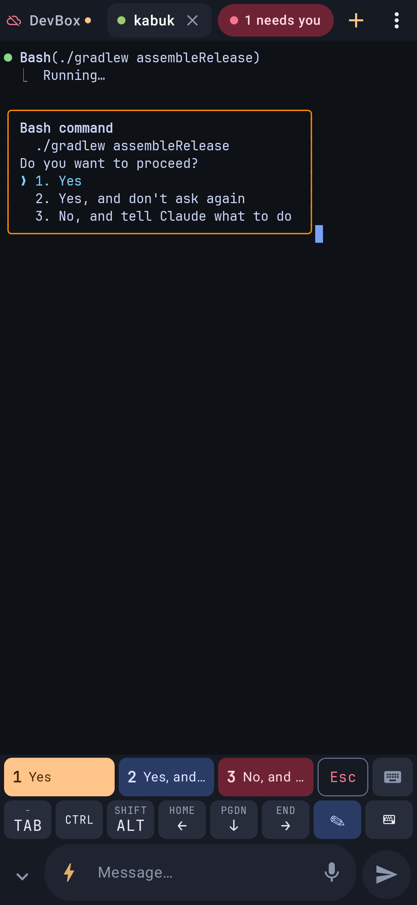
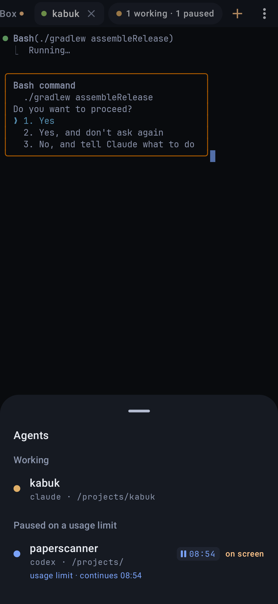

# Kabuk

**Kabuk** (Turkish for "shell") is an Android SSH terminal made for running Claude Code, Codex and other coding
agents on your dev server from a phone. It's a Termux replacement for that job: the same terminal engine, with
better keyboard input, copy and tabs. On top of the terminal there is an agents layer: the agents on the server,
their permission dialogs and the questions they ask you, and the server's workspaces, live on the phone and
answerable from a notification.

The agents layer talks to [**orchtool**](https://github.com/muratbilge/orchtool) (`orchd` + `orch`: panes,
workspaces and an agent bus for Claude Code and Codex) and falls back to **herdr**, which orchtool replaces.
Without either, Kabuk is a good terminal with tmux sessions that survive the connection.

<p align="center">
  
  
</p>
<p align="center">
  
</p>

## What it does

### Agents (orchtool)
- **Start with: orch.** The server's orch TUI runs in the tab, started through a login shell so the TUI, the
  orchd it starts and the agents those spawn get the real environment. Agents, their dialogs, the questions they
  ask you (`ask_human`), the message timeline and the workspace layout stream from `orch watch --json` over the
  same SSH connection; every action is a single `orch` command. Nothing to install besides orch on the server.
- **Agents sheet.** The chip in the tab bar says "1 needs you" or "2 working · 1 paused"; tap it for the agents
  grouped Needs you / Working / Paused on a usage limit / Done / Idle, each with its folder and workspace. A
  waiting agent shows its dialog with the answer buttons right there; tap the row to bring it on screen in the
  TUI. "Asks you" lists the questions agents asked on the bus, with the agent's options, Reply… and Dismiss.
  Comms shows the timeline and Message… to one agent or all. New agent starts Claude or Codex in a folder.
- **Answers that can't go astray.** A dialog is answered with `orch send --expect <screen hash>`: orchd sends
  only if the screen still shows what the phone read, and answers each dialog once, so a second phone or the TUI
  can't answer it again. Every outcome comes back in words: sent, the screen changed, answered already, the agent
  is gone or not taking input, orchd not running, or Kabuk and orch disagree (update one of them). The contract
  with orchtool (its `notes/kabuk-contract-v2.md`), the exit codes and the shared fixture are tested in `OrchContractTest`.
- **Notifications.** "claude needs you · notes-app" with up to three answer buttons (unlock required), one
  notification per bus question with the agent's options, and an optional "finished". Tapping one opens that
  agent. Works with the screen off, because a foreground service keeps the connection alive.
- **Quick replies.** When a numbered choice menu is on screen (Claude Code / Codex approvals), its answers take
  the place of the key bar's top row (`1 Yes` `2 Yes, and…` `3 No…` `Esc` ⌨), so the terminal never changes
  size. One tap answers; "No, and tell Claude…" opens the message box for the reason.
- **Workspace bar.** On an orch server a slim bar under the tab strip shows orchd's workspaces as chips (the
  agents' most urgent status as a dot, the one on screen in the TUI lit) with that workspace's tabs after it.
  Tap = show it in the TUI, long-press = new tab (shell, Claude, Codex), rename, close (confirmed: closing kills
  the panes), + = a new workspace in a folder.
- **Usage limits.** An agent that hit its limit is listed as paused with the time it goes on (orchd types
  "continue" a minute after the reset). Long-press its row, or its tab chip in the bar, to switch that off or on
  per pane.
- **Prompt box for agents.** ⚡ snippets (/clear, /compact, /model, … editable in Settings) and earlier prompts;
  🎤 voice; 🖼 picture → shrunk, uploaded to `~/.cache/kabuk/` over SFTP, and its path put in the prompt.
  Screenshots shared into Kabuk do the same. Each tab has its own draft; text is kept when you're offline.

### herdr (fallback)
"Start with: Auto" picks herdr when the server has it (and an orch server without orch does the same). Kabuk
then runs a small watcher (`assets/herdr_watch.py`) on herdr's event stream for live status, shows waiting agents'
questions in the sheet and in notifications, answers them with `herdr pane send-text` after rechecking that the
question is still open, and starts agents as herdr workspaces. Kept until every server has moved to orchtool.

### Terminal
- **Tabs:** the selected tab has a × button (closing an SSH tab offers Undo). Long-press a tab for Rename,
  Reconnect, Copy text, Move, Duplicate, Close, and End session on server (kills the tmux session). Tabs with new
  output get a dot.
- **Prompt box:** a normal text field with autocorrect, swipe typing and voice input; two lines, ⌃⌄ for a big
  editor, ⌄ hides it (the lit ✎ key brings it back). Send pastes the text as one block and presses Enter; it is
  off while the field is empty. Long-press Send to insert without Enter. The last 50 prompts are kept, encrypted.
- **Key bar:** two rows tuned for Claude Code (ESC, ⇧TAB, /, ⚡ quick messages (swipe up: @), arrows, ^C, ⏎,
  PASTE, TAB, CTRL, ALT, ✎ prompt box, ⌨ keyboard).
  - Swipe a key up for the small label shown on top (e.g. `/`→`\`, `↑`→PgUp, `^C`→`^D`, `⏎`→newline).
  - CTRL and ALT: tap once for the next key only, double-tap to lock.
  - Arrow keys repeat while held.
- **Copy and paste**
  - Long-press selects a word. Drag the big handles; the finger sits below the text, and dragging at the edge
    scrolls. Copy joins wrapped lines.
  - "Copy text…" opens the whole history as normal Android text. On an orch server it is the focused pane's text
    from orchd with wrapped lines joined again (`orch read --unwrapped`), on herdr the focused pane's, on tmux
    `tmux capture-pane`: everything that scrolled by, not just the phone's scrollback.
  - Copy screen, Paste, Ctrl+Shift+C / V on hardware keyboards. Programs can copy to the phone clipboard (OSC 52).
  - Tap a link to open or copy it.
- **Sessions that survive**
  - "Start with" per server: **Auto** (default) = herdr if the server has it, else tmux (`tmux new -A -s main`),
    else a plain shell; **orch** = the orch TUI, else like Auto; **tmux**; **Shell** = a plain shell or your own
    startup command.
  - Automatic reconnect after a drop-out or a Wi-Fi ⇄ mobile switch.
  - A foreground service keeps connections open in the background. Its notification has a wake lock toggle and
    Exit.
- **Reading:** new output doesn't throw you to the bottom while you're reading history; a ⇊ button jumps back
  down. Fling scrolling. In tmux, vim and less, scrolling sends mouse wheel events. In orch, herdr and tmux a tap
  is a click and only opens the keyboard when you tap where you type (or press ⌨).
- **Login**
  - The phone's own Ed25519 key, encrypted with the Android Keystore.
  - After the first password login, the app offers to install its key on the server.
  - Saved passwords are encrypted. Host keys are checked like known_hosts (trust on first use, loud warning if
    one changes).
- **Termux extras:** a phone shell (`/system/bin/sh`), volume keys as Ctrl / Fn (optional), pinch to zoom,
  5 color themes, bell vibration, keep screen on, and text shared from other apps lands in the prompt box.
  Long-press the app icon for per-server shortcuts.

Not included: Termux's package system (`pkg install`). Your server is the Linux machine.

### Updates and logs
- **In-app updater** (Settings → Update → Check for update): `update.json` is signed with a key whose public half
  is compiled in; the APK must match its size, SHA-256, package and signing certificate before Android's
  installer is asked. Publishing: `scripts/release.sh` (see Build). The APK is never handed out as a link.
- **Live log** (Settings → Diagnostics → Live log, on by default while the app is young): connection, agent and
  crash lines go in HMAC-signed batches to `scripts/logsink` on the dev server; read them with `scripts/livelog`.
  Never passwords, prompts, dialog or question text.

### Design
Material 3 dark theme built from the logo (peach primary, blue secondary, pink for "needs you"), snackbars with
Undo/Reconnect, 48dp touch targets, readable key hints, keyboard haptics. Reviewed by a design council
(`PLAN-0.3.md`, `docs/council/`); the orchtool integration by a review council (`docs/council/claude-review-0.5.md`).

## Build

```sh
NOTES="what changed" scripts/release.sh   # build, zipalign, sign, verify → ~/apks/kabuk/kabuk-<ver>.apk, then
                                          # publish kabuk-<code>.apk + signed update.json to ~/apk-share/kabuk
                                          # for the in-app updater (PUBLISH=0 skips that step)
./gradlew :app:testDebugUnitTest          # unit + screenshot tests → app/build/outputs/roborazzi/*.png
```

Needs a JDK 17 and Android build-tools 35. The version lives in `app/build.gradle.kts` (`appVersionName`,
`appVersionCode`); a published versionCode is never reused, bump it for every release.

The SSH integration test needs a throwaway server:

```sh
docker run -d --name kabuk-sshd-test -p 127.0.0.1:2222:2222 -e USER_NAME=test -e USER_PASSWORD=kabuktest \
  -e PASSWORD_ACCESS=true lscr.io/linuxserver/openssh-server && docker exec kabuk-sshd-test apk add tmux
KABUK_TEST_SSH=127.0.0.1:2222 ./gradlew :app:testDebugUnitTest --tests app.kabuk.SshIntegrationTest
docker rm -f kabuk-sshd-test
```

## Architecture

```
term/   TermTab (one tab) → SshTab (sshj, reconnect loop, the orch/herdr streams) / LocalTab (Termux TerminalSession)
        TerminalCanvasView: draws with Termux's TerminalRenderer; own touch, selection and keyboard handling
        TabManager: all tabs, prompts for background threads, clipboard; Themes
agents/ Orch (orchtool: watch stream, answers, bus, workspaces), Herdr (herdr CLI over SSH), AnswerLedger (answer
        once), AgentNotifier + AnswerReceiver (needs-you / asks-you / finished notifications with answer buttons)
text/   Unwrap (re-join wrapped lines), QuickReplies (numbered menus on screen)
ssh/    KeyPairStore (Ed25519 via BouncyCastle), HostKeys (trust on first use)
data/   Hosts (servers and their start mode), Settings, SecretBox (Keystore AES-GCM)
update/ Updater (download, verify, PackageInstaller), UpdateManifest (signed update.json)
log/    KLog (logger + crash handler), LogShipper (HMAC-signed batches to scripts/logsink)
service/SessionService: foreground service + wake lock
ui/     Compose: terminal, key bar, prompt box, agents sheet, workspace bar, servers, settings + updater, copy text
```

Libraries: Termux terminal-emulator / terminal-view (Apache 2.0), sshj, BouncyCastle, Jetpack Compose.
Font: JetBrains Mono (OFL, see FONT-LICENSE-OFL.txt).

## History

- **0.5.9 — new workspace in the right folder.** The dialog lists the server's folders (home, its subfolders,
  ~/projects/*, /projects/*, /docker/*) and filters them as you type; a tap fills the field. Before starting, Kabuk
  asks the server whether the folder exists: a missing ~/projects/x whose /projects/x exists offers that one, any
  other missing folder can be created (`mkdir -p`) first. Errors and the log name the path.
- **0.5.8 — paused agents, dismiss, unwrapped copy.** An agent that hit its usage limit (orchtool status
  `limited`, 7c47764) is listed under "Paused on a usage limit" with a ⏸ badge and the time it goes on (orchd
  types "continue" a minute after the reset; the tab bar's chip counts it as paused). Long-press its row, or its
  tab chip in the workspace bar, to switch that off or on per pane (`orch auto-continue`). "Asks you" cards have
  Dismiss (`orch question close`: 14 gone, 11 answered already). "Copy text…" on an orch pane reads it
  `--unwrapped`, so a long line comes as one line (an older orch without the flag: as before).
- **0.5.7 — native workspace bar.** On an orch server a slim bar under the tab strip shows orchd's workspaces as
  chips (the agents' most urgent status as a dot, the one on screen in the TUI lit) with that workspace's tabs after
  it; tap = show it in the TUI (`orch ws focus`, `orch tab focus`), long-press = new tab (shell, Claude, Codex),
  rename, close (confirmed: closing kills the panes), + = a new workspace in a folder. The layout comes with the
  watch line (`workspaces`, orchtool 1f30b5f); tabs are addressed by id, so a tab closed meanwhile is "gone" (exit
  14), never another tab. Hidden on herdr servers and while orchd is down.
- **0.5.6 — real Claude Code dialogs.** While a permission box waits, Claude Code pulses the bullet of the pending
  tool line every second, so the whole-screen hash orchd checks keeps changing and the four lines Kabuk
  fingerprints could too. The fingerprint now ignores bullets and ticking spinner lines (real screens in the test
  fixtures `claude-*-box-*.txt`); a send refused as "changed" is retried with a fresh read while the dialog is
  still the same; after a real change the inbox shows the dialog that is actually on screen at once.
- **0.5.5 — one orch call per answer.** The watch line carries each blocked pane's screen hash (orchtool
  e3a0257); when the dialog on the phone still matches the stream, the answer is a single `orch send --expect`
  without rereading the pane. Older orch, or a stale dialog: reread as before.
- **0.5.4 — fixes from orchtool's review of Kabuk.** The orch TUI and agents started from the phone run through a
  login shell (real PATH and profile). A herdr pane's dialog is never retried (no answered-once memory there); a
  screen that changed after a silent try is "Unsure", not "changed"; the answer ledger survives stream gaps and is
  kept where a retap could type twice. An orch server without orch (or with one too old for `orch watch`) falls back
  to herdr for the agents too. One notification per `ask_human` (no extra "needs you"). Notification buttons name the
  server and are dropped when stale; old notifications are cleared at start. Unchanged heartbeat lines are skipped.
- **0.5.3 — honest contract with orchtool.** Every answer reports what orch said (exit-code table in orchtool's
  `notes/kabuk-contract-v2.md`): the screen changed, answered already, the agent is gone or not taking input,
  orchd not running, or Kabuk and orch disagree (update one of them). No reply in time → one retry (orchd answers
  each screen once, so a landed first try is recognised), then "Unsure". The watch line's `v` is checked: a newer
  orch shows "update Kabuk" in the agents sheet. Reply chips on an orch server answer the dialog's own pane
  through `orch send --expect`, never whatever pane the TUI shows. A malformed watch line is logged without its
  text. Test: `OrchContractTest` (shared fixture `orch-watch-v1.json`, the exit codes through a real `sh`).
- **0.5 — orchtool, updater, live log.** "Start with: orch"; the in-app updater; the live log.
- **0.4 — herdr native.** Live status from herdr's event stream, answers from the notification, the agents
  inbox, New agent.
- **0.3 — design.** Material 3 theme from the logo, reviewed by a design council.
- **0.2 — for agents.** Agents panel, notifications, quick replies, the prompt box with snippets, voice and
  pictures.
- **0.1 — the terminal.** Termux's engine with better keys, copy and tabs; tmux sessions; Ed25519 login.

## License

Apache License 2.0, see `LICENSE`. Uses Termux's terminal-emulator and terminal-view (Apache 2.0), sshj
(Apache 2.0), Bouncy Castle (MIT) and the JetBrains Mono font (SIL OFL 1.1, `FONT-LICENSE-OFL.txt`).

`scripts/release.sh` signs with Android's debug key, which is fine for your own phone. To hand the app to
others, sign it with your own release key.
